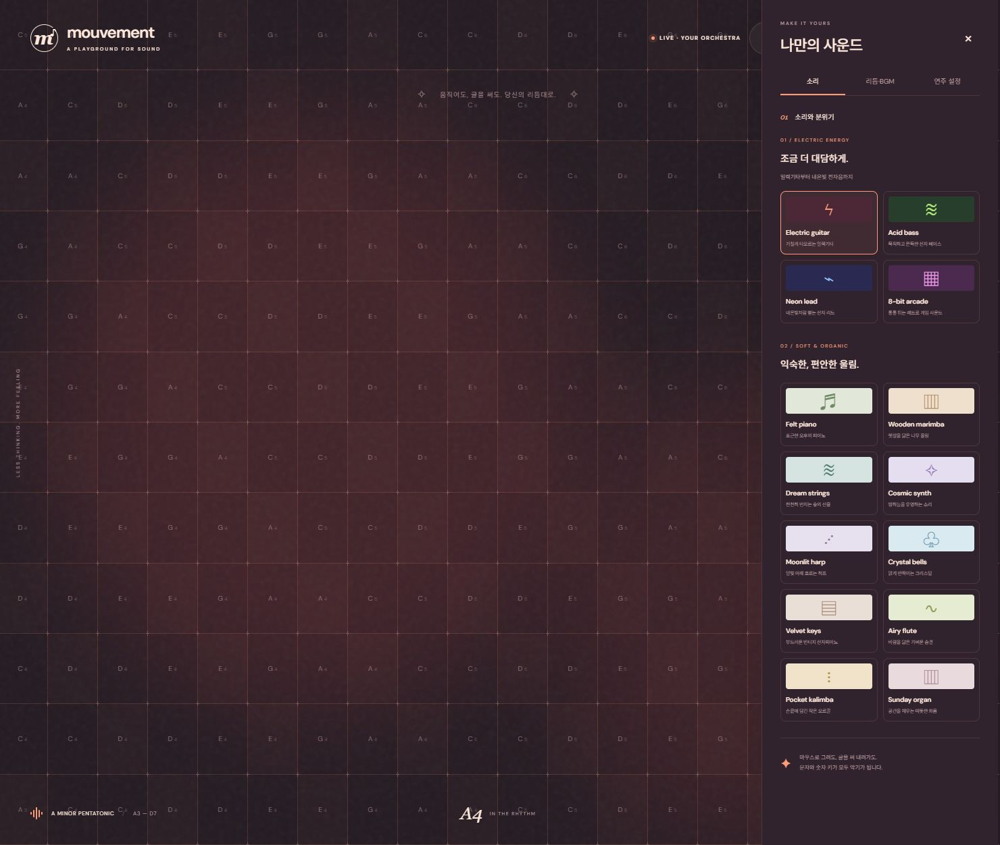

# Mouvement

**움직임이 음악이 되는 순간.** 마우스로 화면을 지휘하거나 글을 쓰며 나만의 음악을 연주하는 웹사이트입니다.

악보를 몰라도 괜찮습니다. 서로 어울리는 음정으로 채워진 화면에서 선율을 만들고, 계속 변화하는 BGM 위에 즉흥 연주를 더해 보세요.

[사이트 열기](https://mixx98.github.io/Mouvement/) · [변경 이력](CHANGELOG.md) · [버전 태그](https://github.com/Mixx98/Mouvement/tags)

> GitHub Pages에서 로그인 없이 바로 연주할 수 있습니다.



## 주요 기능

| 기능 | 설명 |
| --- | --- |
| 화면 전체 연주 | 마우스·터치로 음정을 연주합니다. 오른쪽·위쪽일수록 높은 음이며 격자 밀도는 3단계입니다. |
| 글로 연주 | 한글·영문·숫자·문장부호 입력이 선율이 됩니다. 고정·랜덤 음정과 최대 6음 화음을 지원합니다. |
| 14가지 음색 | 피아노부터 디스토션 일렉기타까지, 선택하면 화면 테마도 바뀝니다. |
| 분위기로 선택 | 포근한 위로, 햇살 같은 기분, 비 오는 밤, 숲속의 쉼, 꿈속을 걷듯, 새로운 시작을 고르면 악기·음계·잔향을 함께 맞춥니다. |
| 변화하는 BGM | 8마디마다 코드 진행·리듬·멜로디가 달라지며 현재 반주에 맞춘 음정 보정을 지원합니다. |
| 박자 맞춤 | 30–240 BPM, 자유 연주 또는 한 박자·반 박자·¼박자 간격을 지원합니다. |
| 세부 설정 | 조성·음계·음량·잔향·음이름 표시를 조절합니다. |

### 사운드 컬렉션

| 전자 악기 | 부드러운 악기 |
| --- | --- |
| Electric guitar — 거친 디스토션 기타 | Felt piano · Wooden marimba · Dream strings |
| Acid bass — 낮고 쫀득한 베이스 | Cosmic synth · Moonlit harp · Crystal bells |
| Neon lead — 밝게 뻗는 전자 리드 | Velvet keys · Airy flute · Pocket kalimba |
| 8-bit arcade — 레트로 게임 사운드 | Sunday organ |

모든 음색은 **Web Audio API로 합성**하며 실제 악기 녹음이나 외부 오디오 파일을 사용하지 않습니다.

### 매번 다르게 흐르는 반주

- **느린 오후:** 포근한 건반과 스윙감 있는 로파이 비트
- **숲의 호흡:** 드럼 없이 스트링·하프의 여백을 살린 앰비언트
- **별빛 산책:** 신스와 펄스가 흐르는 칠 전자음악

6가지 코드 진행과 테마별 4가지 리듬을 조합하며, 이웃한 8마디 구간은 같은 진행·리듬을 반복하지 않습니다. 멜로디 음형, 코드의 높낮이, 강세와 짧은 필인도 달라집니다. BGM 시작 또는 테마 선택 시 새 편곡을 만들고, 사용자 연주는 현재 코드에 맞춰 보정할 수 있습니다.

## 시작하기

라이브러리 설치나 빌드 과정이 없는 정적 사이트입니다. Python 3으로 실행할 수 있습니다.

```bash
git clone https://github.com/Mixx98/Mouvement.git
cd Mouvement
python -m http.server 4173 --bind 127.0.0.1
```

브라우저에서 **http://127.0.0.1:4173**을 열고 **나의 연주 시작하기**를 누르세요. 첫 클릭은 브라우저의 오디오 재생을 활성화합니다. 환경에 따라 `python` 대신 `python3`을 사용하세요.

`index.html`을 직접 열어 사용할 수도 있지만 개발 중에는 로컬 서버 사용을 권장합니다.

## 연주 방법

1. 연주를 시작하고 화면 위에서 마우스를 움직입니다. 터치 기기에서는 화면을 쓸어 연주합니다.
2. 오른쪽 **SOUND STUDIO**에 마우스를 올리거나 상단 음색 버튼을 눌러 소리를 고릅니다.
3. **글로 연주**를 열어 문장을 입력하거나 **BGM과 합주**로 반주를 시작합니다.
4. **리듬·BGM**에서 빠르기와 박자 맞춤을, **연주 설정**에서 분위기와 음계를 조절합니다.

| 입력 | 동작 |
| --- | --- |
| 마우스 이동·클릭 / 터치 | 해당 칸의 음정 연주 |
| 문자·숫자·문장부호 키 | 음정 연주 |
| 글쓰기 밖의 `Space` | 일시정지·재개 |
| `Escape` | 설정 또는 글쓰기 닫기 |

글쓰기 중에는 공백을 평소대로 입력할 수 있습니다. 키보드 연주는 페이지에 포커스가 있을 때 동작합니다. 여러 키를 함께 누르거나 화면에 여러 손가락을 올리면 최대 6음의 화음을 연주합니다. 여러 글자를 한 번에 입력하거나 붙여넣을 때도 화음으로 연주합니다. 같은 음은 중복하지 않으며 음량을 보정합니다.

처음에는 항상 자유 모드로 시작합니다. BGM을 켜면 박자 맞춤으로 전환하고, 끄면 자유 모드로 돌아옵니다. 재생 중에도 직접 모드를 선택할 수 있습니다. 박자 맞춤에서는 동시에 누르고 있는 음을 다음 박자에 함께 연주하며, 순서대로 빠르게 입력하는 글은 마지막 입력만 연주해 긴 대기열을 만들지 않습니다.

모바일 뒤로가기는 열려 있는 설정창을 먼저 닫습니다. 설정창은 제목·탭을 고정한 채 본문을 스크롤하고, 상단 악기 버튼과 사이드 탭 모두 같은 슬라이드 동작으로 열립니다.

## 개발 및 검증

검사에는 **Node.js 18 이상**이 필요하며 별도 패키지 설치는 필요하지 않습니다.

```bash
npm test
npm run check
```

음정 범위, 합주 보정, 편곡 변화·일관성, 박자 동기화, 디스토션 곡선, 한글 조합 및 가상 키보드의 중복 입력 방지를 검사합니다. GitHub Actions가 푸시와 Pull Request마다 같은 검사를 실행합니다. 실제 음색과 화면 동작은 브라우저에서 별도로 확인하세요.

```text
Mouvement/
├── index.html            # 사이트 진입점
├── style.css             # 악기별 테마와 반응형 스타일
├── studio.css            # 설정창 레이아웃과 접근성 개선
├── app.js                # 오디오 엔진, 스케줄러, 입력과 UI
├── music.js              # 음계, 악기, 편곡과 음악 규칙
├── assets/               # 사이트 아이콘과 공유 카드 이미지
├── scripts/              # 브랜드 그래픽 재생성 도구
├── tests/music.test.cjs  # 음악·입력 로직 테스트
├── docs/preview.jpg      # README 화면 미리보기
├── .github/workflows/    # 자동 검사
├── .openai/hosting.json  # 기존 Sites 배포 설정
├── .nojekyll             # GitHub Pages 정적 파일 제공
├── CHANGELOG.md          # 버전별 변경 이력
└── package.json          # 버전과 검사 명령
```

.github의 자동 검사는 사이트 배포와 별도로 실행됩니다. GitHub Pages에서는 **Settings → Pages → Deploy from a branch → main → /(root)**를 선택하면 됩니다. GitHub Actions로 배포하는 경우 업로드 경로를 `.`으로 지정하세요. 다른 정적 호스팅에서도 저장소 최상위(`.`)를 게시 디렉터리로 지정하면 됩니다. `.openai/hosting.json`은 기존 Sites 배포 설정이며 일반 정적 호스팅에는 필요하지 않습니다.

## 버전 관리

현재 버전은 **1.2.0**입니다. `main`에서 커밋 이력을 관리하고 릴리스 기준점에는 `v1.0.0` 형태의 주석 달린 Git 태그를 남깁니다.

- **PATCH** (`1.0.1`): 오류 수정
- **MINOR** (`1.1.0`): 기존 사용 방식을 유지하는 기능 추가
- **MAJOR** (`2.0.0`): 기존 사용 방식과 호환되지 않는 큰 변경

변경 시 `CHANGELOG.md`의 `Unreleased`에 기록하고, 릴리스할 때 `package.json`의 버전과 함께 확정합니다. 태그는 해당 릴리스 커밋을 가리키며 기존 태그를 덮어쓰지 않습니다.

## 데이터와 브라우저 동작

입력한 글은 저장하거나 전송하지 않습니다. 환경설정만 현재 브라우저의 `localStorage`에 저장됩니다. 오디오는 브라우저 안에서 처리합니다. 글꼴은 Google Fonts에서 불러오며 연결이 없으면 시스템 글꼴을 사용합니다. 탭을 벗어나면 오디오를 멈추고 돌아오면 반주를 다시 시작합니다.

## 링크 공유와 아이콘

사이트 아이콘(SVG·PNG·ICO), iOS 홈 화면 아이콘 및 1200×630 공유 이미지를 제공합니다. 카카오톡 등 링크 미리보기는 HTML의 Open Graph 제목·설명·이미지를 사용합니다.

브랜드 그래픽은 `scripts/generate-brand-assets.py`에서 관리합니다. 재생성에는 Python과 Pillow가 필요하며, Windows 기본 글꼴을 사용합니다. 다른 환경은 `--serif-font`, `--text-font`, `--bold-font`로 글꼴 파일 경로를 지정하세요. 사이트 실행과 테스트에는 Pillow가 필요하지 않습니다.
